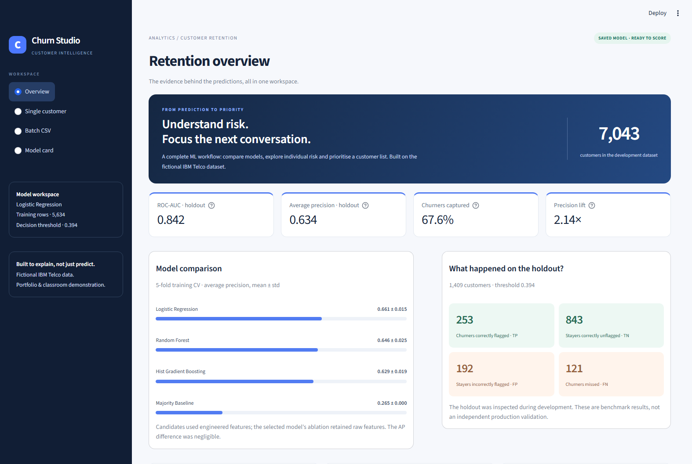
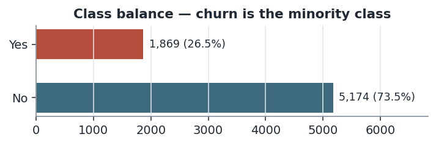
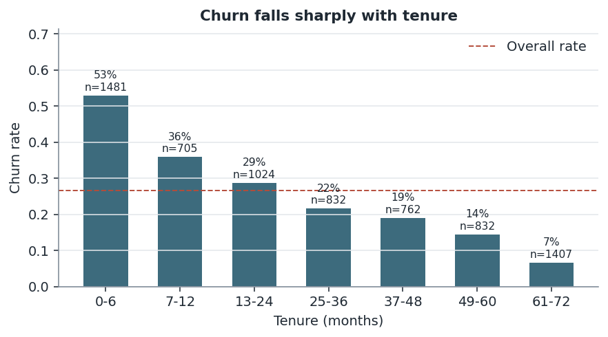
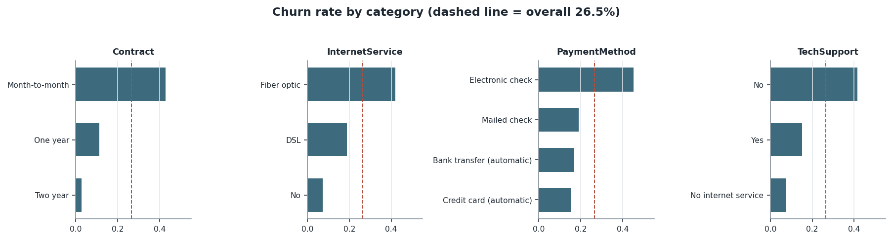
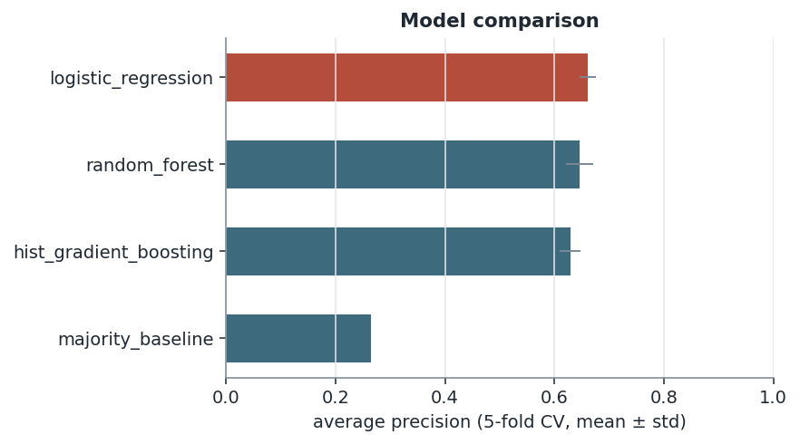
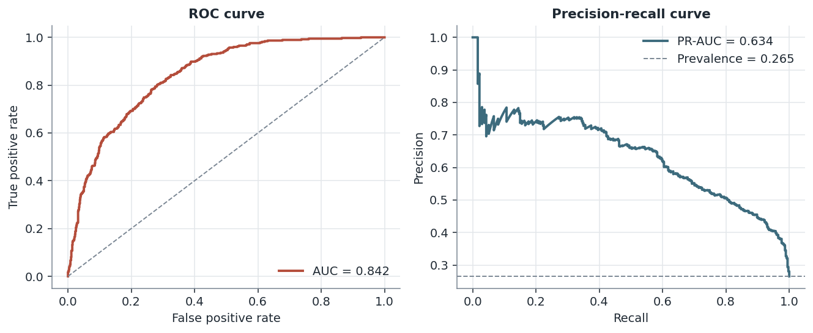
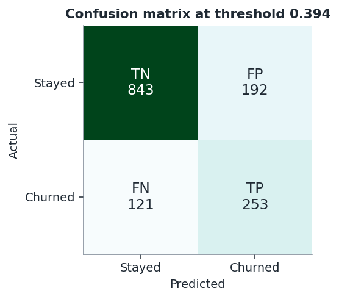
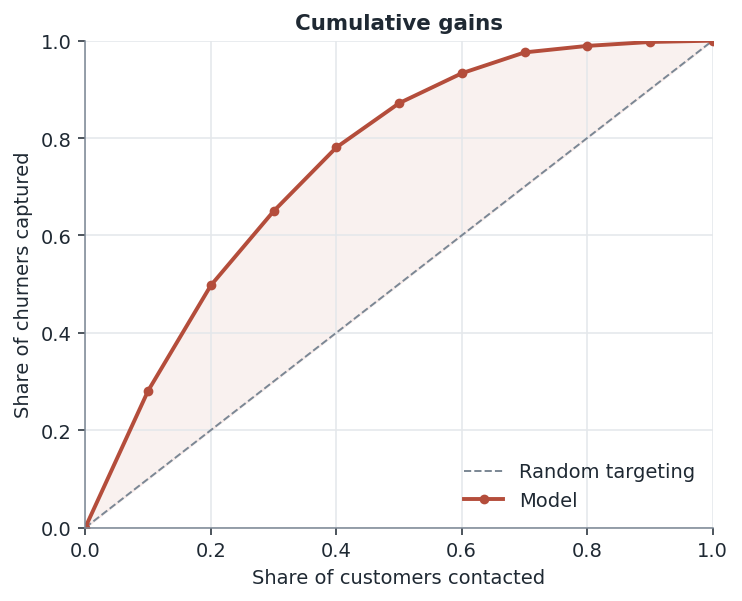
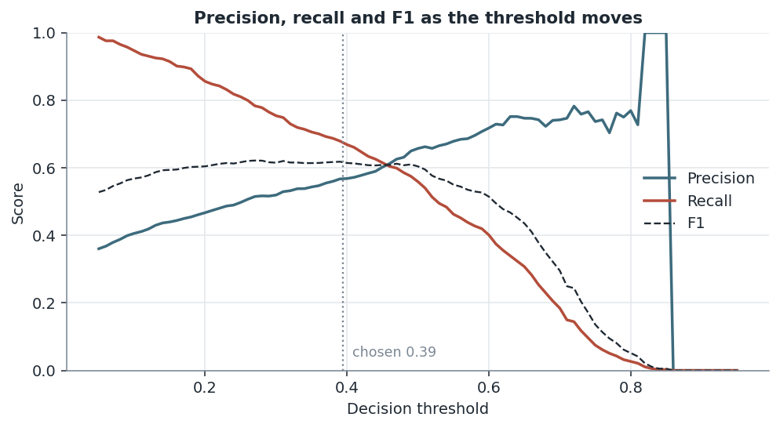
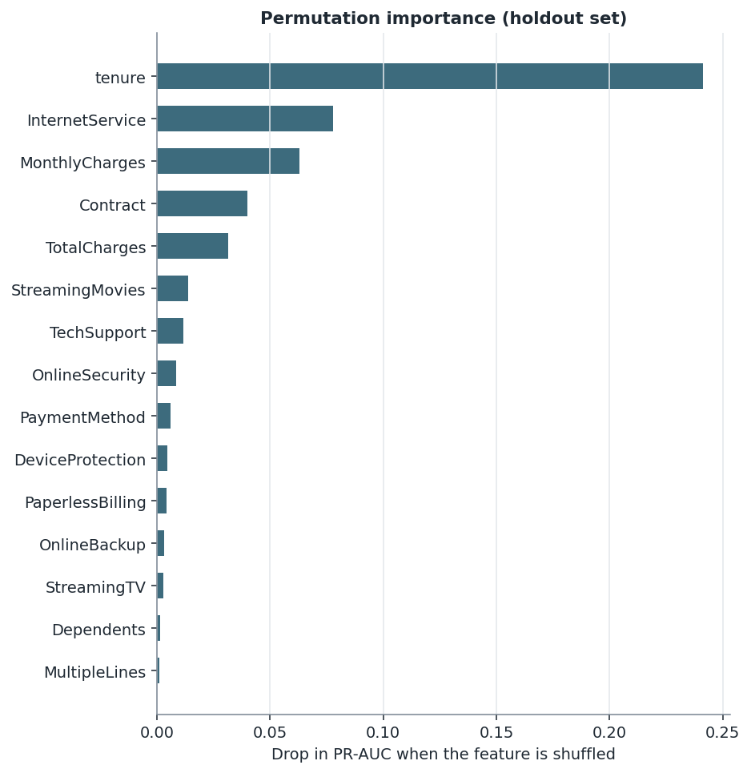

# Customer Churn Prediction

A machine-learning project for estimating telecom customer churn and prioritising retention outreach. It includes exploratory analysis, model comparison, evaluation charts, a trained scikit-learn pipeline, batch predictions and an interactive Streamlit app.

## Dashboard preview



Navigate from the sidebar:

- **Overview:** saved evaluation metrics, model comparison and holdout outcomes.
- **Single customer:** editable demo profiles, a compact account form and a risk assessment. Changing inputs clears the previous prediction until you score again.
- **Batch CSV:** upload a file or use the local demo dataset, inspect risk distribution and download all scores. Uploaded files take priority over the demo selection.
- **Model card:** switch between ROC/PR curves, confusion matrix, feature importance, calibration and gains, with explanations and limitations.

All displayed evaluation figures come from the saved report; the dashboard does not fabricate live activity or revenue estimates.

**Start here:** [Jupyter classroom demo](notebooks/02_live_demo.ipynb) · [Paste-ready Python code](scripts/notebook_demo.py) · [Local setup](#run-locally) · [Model card](reports/model_card.md)

## Results

The IBM Telco dataset contains **7,043 fictional customer records**, with **26.5% churn**. A stratified 80/20 split leaves 1,409 records for evaluation. Models are compared on the training set using five-fold cross-validation; logistic regression was selected by average precision.

| Holdout metric | Result |
|---|---:|
| ROC-AUC | 0.842 |
| Average precision (AP) | 0.634 |
| Precision | 0.569 |
| Recall | 0.676 |
| F1 | 0.618 |
| Accuracy | 0.778 |

At the selected threshold of **0.394**, the model flags 445 customers and identifies 253 of 374 actual churners. Its precision is approximately **2.14×** the holdout churn rate. Predicting that nobody churns would reach about 73.5% accuracy, so accuracy alone is not a useful comparison.

The threshold was selected from out-of-fold training predictions to target approximately 30% outreach. It flags **31.6%** of the holdout; tied scores and population changes can produce a different share. For a strict capacity limit, rank the current batch and apply a deterministic tie-breaker.

### Model comparison

| Candidate | Training CV average precision | Training CV ROC-AUC |
|---|---:|---:|
| Logistic regression | 0.661 ± 0.015 | 0.848 ± 0.011 |
| Random forest | 0.646 ± 0.025 | 0.839 ± 0.009 |
| Histogram gradient boosting | 0.629 ± 0.019 | 0.828 ± 0.007 |
| Majority baseline | 0.265 | 0.500 |

These candidate comparisons use the engineered feature pipeline. A subsequent cross-validation ablation on the selected model compared engineered features with raw features: AP was 0.6614 versus 0.6617 respectively, so the final model uses raw features. The difference is negligible, not strong evidence that raw features are better. Average precision is a summary of the precision-recall curve; it is reported as PR-AUC in the generated charts. Out-of-fold results are affected by model and feature selection on the same training data; a genuinely independent test is needed for a stronger estimate.

### Confusion matrix at the selected threshold

| | Predicted stayed | Predicted churned |
|---|---:|---:|
| Actual stayed | 843 | 192 |
| Actual churned | 121 | 253 |

The top-scoring 10% of holdout customers contain 105 of the 374 churners. The complete decile table is in [`reports/decile_lift.csv`](reports/decile_lift.csv).

## ML workflow

```text
IBM Telco CSV → cleaning → stratified train/holdout split
                               ↓
                  training-only cross-validation
                  baseline + logistic regression
                  random forest + gradient boosting
                               ↓
             select model and feature set on training data
                               ↓
             out-of-fold training scores → threshold
                               ↓
             fit pipeline → evaluate holdout → save model
                               ↓
                  Streamlit app / batch CSV scorer
```

Numeric imputation and scaling, categorical encoding, and the estimator are inside the scikit-learn pipeline. The fixed, row-wise `TotalCharges` cleaning rule is applied before splitting; there are no learned dataset-wide statistics in that rule. The 11 blank values, all with zero tenure, are treated as zero. The notebook describes the complete dataset, including the eventual holdout, so its charts should be considered exploratory.

## Diagrams

### Data exploration





Additional plots: [numeric distributions](reports/figures/eda_numeric_by_churn.png) and [correlation matrix](reports/figures/eda_correlation.png).

### Model evaluation








Additional plots: [calibration](reports/figures/calibration.png), [risk-band outcomes](reports/figures/band_performance.png) and [illustrative penalty curve](reports/figures/threshold_cost_curve.png). Permutation importance measures how much a feature affects this model's score; it does not prove causation.

## Run locally

Use Python 3.10 or later. Clone the repository, open its root folder, and create a virtual environment:

```bash
git clone https://github.com/lakshysingh156/customer_churn_prediction_ml.git
cd customer_churn_prediction_ml
python -m venv .venv
```

Activate it on Windows:

```powershell
.venv\Scripts\Activate.ps1
```

On macOS or Linux:

```bash
source .venv/bin/activate
```

Then install dependencies and start the app:

```bash
python -m pip install -r requirements.txt
python scripts/download_data.py
python -m streamlit run app/streamlit_app.py
```

The trained model is already included. The raw CSV is **not tracked in Git**; the download script retrieves a fixed IBM source revision, checks its SHA-256, and refuses to overwrite a different existing file. Your local demo copy can stay under `data/raw/`. Run commands from the project root so Streamlit picks up the included light theme. For tests and notebook tools, install `requirements-dev.txt` instead.

### Classroom / Jupyter demo

Open [`notebooks/02_live_demo.ipynb`](notebooks/02_live_demo.ipynb) in Jupyter or VS Code, select your Python environment, and **Restart Kernel → Run All**. It is self-contained: it uses pandas, matplotlib and scikit-learn directly, needs only the Telco CSV, and does not import this project's package or load a serialized model. Executed outputs are included for reviewing without rerunning.

Prefer one pasteable code block? Copy all of [`scripts/notebook_demo.py`](scripts/notebook_demo.py) into a new notebook cell. If the CSV is not found, set `CSV_PATH` near the top to its full path, for example `r"C:\Users\YourName\Downloads\Customer-Churn-Prediction\data\raw\telco_churn.csv"`. You can also run `python scripts/notebook_demo.py` from the terminal. The demo neither overwrites the supplied model nor writes prediction files.

Install dependencies into the notebook's selected environment first; from a notebook, use a separate setup cell:

```python
%pip install pandas==2.3.3 numpy==2.2.6 scikit-learn==1.7.2 matplotlib==3.10.8
```

If you do not already have a notebook interface, install JupyterLab in the project virtual environment with `python -m pip install jupyterlab`, then run `python -m jupyterlab notebooks/02_live_demo.ipynb`.

**Suggested five-minute walkthrough**

1. Explain the target: estimate whether a customer will churn, not why they will leave.
2. Show class imbalance and the 11 blank `TotalCharges` values; justify the zero-tenure cleaning rule.
3. Explain the stratified 80/20 split and preprocessing inside the pipeline to avoid leakage.
4. Show logistic regression versus the majority baseline, and explain precision, recall, AP and ROC-AUC.
5. Explain that the outreach threshold comes from training predictions, then show the confusion matrix, PR curve, calibration and feature importance.
6. Run the example customer prediction. Switch to the app, score a single customer, then upload `data/raw/telco_churn.csv` in **Batch CSV** and download scores.

This deliberately small demo uses **three-fold CV and one preselected model**, not the full project's five-fold multi-model selection and ablation. Its numbers can differ slightly from the saved report. The dataset and holdout were already inspected during development; demo predictions are not independent validation. Feature importance shows model reliance, not causation.

The separate [`notebooks/01_eda.ipynb`](notebooks/01_eda.ipynb) contains the extended exploratory analysis.

### Retrain and test

```bash
python scripts/download_data.py
python scripts/eda.py
python scripts/train.py
python -m pip install -r requirements-dev.txt
python -m pytest
```

Full training updates `artifacts/`, `reports/metrics.json`, `reports/decile_lift.csv` and the evaluation figures. `python scripts/train.py --quick` runs a smaller smoke test and saves its model and reports under `artifacts/quick/`, leaving the app's full-run outputs untouched. Use `--out-dir path/to/experiment` to choose another location; explicitly choosing `artifacts/` will overwrite the default outputs.

New training runs record a SHA-256 fingerprint of the input dataset and model. The app checks that its model, metadata and metrics match; these hashes detect accidental mismatches, not malicious artifacts.

### Batch prediction

Upload a CSV in the app or run:

```bash
python scripts/score_customers.py data/raw/telco_churn.csv --out scored_customers.csv
```

Input uses the original Telco feature columns; `customerID` is optional and `Churn` is ignored. The output contains the probability, prediction, risk band and a suggested action. Customer IDs are read as text, preserving leading zeroes; import that column as text when opening the CSV in a spreadsheet. To reduce spreadsheet formula injection, IDs beginning with formula characters or leading control characters are prefixed with an apostrophe in the preview and both CSV download routes. Values are case-sensitive; missing categories, values not seen during training, and inconsistent service combinations are rejected. Training additionally requires non-empty, unique customer IDs.

| Fields | Accepted values |
|---|---|
| `gender` | `Female`, `Male` |
| `Partner`, `Dependents`, `PhoneService`, `PaperlessBilling` | `Yes`, `No` |
| `MultipleLines` | `Yes`, `No`, `No phone service` |
| `InternetService` | `DSL`, `Fiber optic`, `No` |
| `OnlineSecurity`, `OnlineBackup`, `DeviceProtection`, `TechSupport`, `StreamingTV`, `StreamingMovies` | `Yes`, `No`, `No internet service` |
| `Contract` | `Month-to-month`, `One year`, `Two year` |
| `PaymentMethod` | `Electronic check`, `Mailed check`, `Bank transfer (automatic)`, `Credit card (automatic)` |
| `SeniorCitizen`, `tenure`, `MonthlyCharges`, `TotalCharges` | Senior citizen is 0 or 1; tenure is a whole non-negative number of months; charges are non-negative numbers. `TotalCharges` may be blank only when tenure is 0. |

`MultipleLines` must be `No phone service` exactly when `PhoneService` is `No`. Each internet add-on must be `No internet service` exactly when `InternetService` is `No`. The provided dataset is an example input. Only load trusted joblib artifacts: loading a malicious pickle/joblib file can execute code.

## Project structure

```text
Customer-Churn-Prediction/
├── .github/workflows/    Automated tests
├── .streamlit/           Light theme configuration
├── app/                  Streamlit application
├── artifacts/            Trained model and metadata
├── data/                 Dataset and provenance
├── notebooks/            EDA and standalone live-demo notebooks
├── reports/              Metrics, model card, training log and figures
├── scripts/              Dataset download, EDA, training, scoring and live demo
├── src/churn/            Data preparation, ML pipeline and evaluation
├── tests/                Unit, integration and app tests
├── .gitignore            Local files excluded from Git
├── LICENSE               Project code license
├── README.md             Project overview and instructions
├── pyproject.toml        Package and test configuration
├── requirements.txt      Runtime dependencies
└── requirements-dev.txt  Test and notebook dependencies
```

See the [model card](reports/model_card.md) for evaluation details and limitations. Do not commit real customer data or secrets to a public repository.

## Limitations

- The dataset is fictional and the split is random, not time-based. The holdout and full-data EDA have been inspected during project development; evaluate on independent future data before making deployment claims.
- The model predicts churn risk, not the causal effect of a retention offer. Risk bands and suggested actions are demonstration aids, not validated business decisions.
- The penalty chart uses arbitrary false-positive and false-negative penalties. It is **not** a measured campaign cost, profit or saving.
- Probabilities and fixed score bands can drift on different customer populations. The model includes demographic fields and needs fairness review before any real use.
- Only load the supplied model if you trust its source; serialized models are not safe for untrusted uploads.

## Dataset and license

Dataset source: [IBM Telco Customer Churn repository](https://github.com/IBM/telco-customer-churn-on-icp4d); see [`data/README.md`](data/README.md) for provenance, the pinned revision and checksum. IBM describes its code pattern as Apache-2.0, but the dataset's separate redistribution terms are not established here, so this repository does not bundle the raw CSV. Review the source terms for your intended use. The included MIT license applies to this project's code, not automatically to third-party data.
